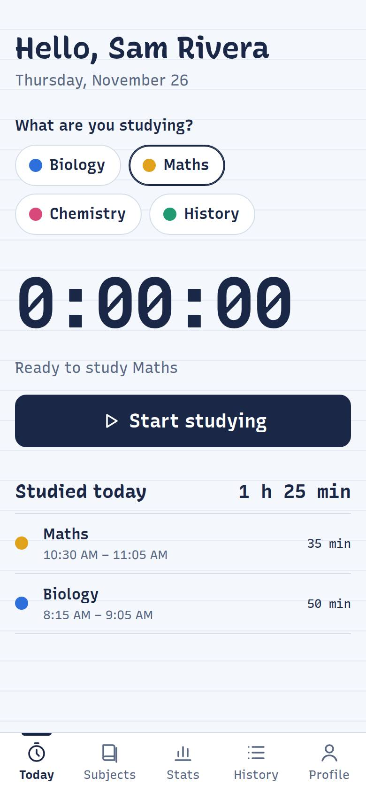
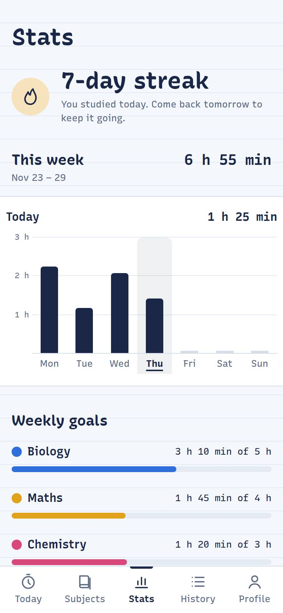
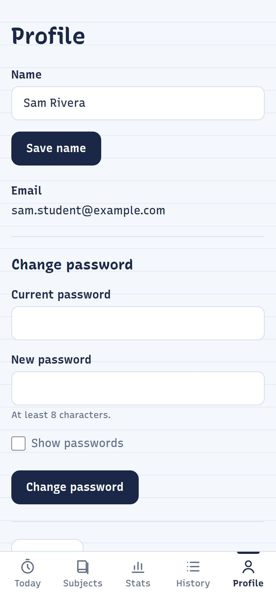
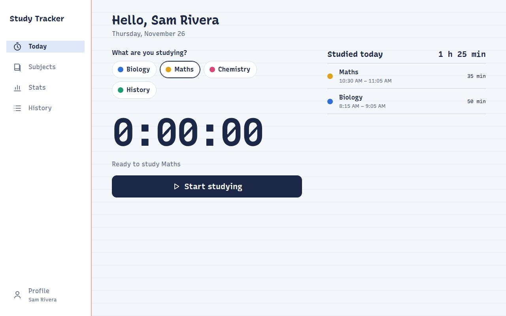
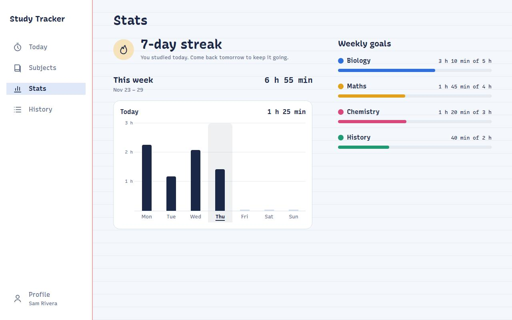
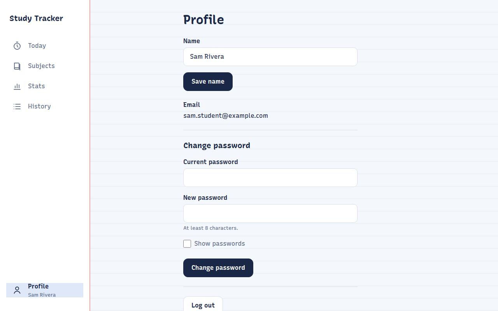

# Study Tracker

A study timer for students: time each session, set weekly goals per subject, and keep your streak going.

**Live app:** https://study-tracker22.vercel.app

## Screenshots

**Phone**

| Today | Stats | Profile |
|---|---|---|
|  |  |  |

**PC**



| Stats | Profile |
|---|---|
|  |  |

The screenshots use a demo account with made-up data.

## Features

- **Study timer:** pick a subject and start. The timer keeps running if you close the app.
- **Subjects:** each has a color and an optional weekly goal in hours.
- **Stats:** a bar chart of this week, progress toward each goal, and your study streak.
- **History:** past sessions grouped by day, and you can delete mistakes.
- **Accounts:** sign up with your name, email and password. Your data follows you to any device.
- **Profile:** change your name or password, or log out.
- **Every screen size:** a bottom tab bar on phones, a side rail on tablets, and a sidebar with 2-column screens on a PC.
- **Swipe:** on touch screens, swipe left or right to change tabs.
- **Installable PWA:** add it to your home screen. It opens offline and shows the copy of your data saved on the device.

## Tech stack

| Part | Used for |
|---|---|
| [React](https://react.dev) | The screens and components |
| [Vite](https://vite.dev) | Running the app while developing and building it |
| [Supabase](https://supabase.com) | Auth (email + password) and a PostgreSQL database with Row Level Security |
| Plain CSS | Styling, with colors and fonts in CSS variables |
| Node's built-in test runner | Unit tests, with no extra test library |
| [Vercel](https://vercel.com) | Hosting the live app |

## Run it locally

You need **Node.js 22.12 or newer** (or 20.19+) and a free Supabase project (see the next section).

```bash
git clone https://github.com/Sleeman01/study-tracker.git
cd study-tracker
npm install
cp .env.example .env.local
```

Open `.env.local` and replace the placeholders with your own values from Supabase → **Project Settings → API**:

```bash
VITE_SUPABASE_URL=https://your-project-id.supabase.co
VITE_SUPABASE_ANON_KEY=your-anon-or-publishable-key
```

Then start the app and open http://localhost:5173:

```bash
npm run dev
```

If you change `.env.local`, stop `npm run dev` and start it again.

## Supabase setup

1. **Create the tables:** go to **SQL Editor** → New query, paste all of `supabase/schema.sql`, and press **Run**. This creates `subjects` and `sessions` with Row Level Security. It's safe to run again.
2. **Site URL** (Authentication → URL Configuration): your live address, e.g. `https://study-tracker22.vercel.app`.
3. **Redirect URLs** (same page): add `http://localhost:5173` and your live address. "Forgot password" links only open addresses on this list.
4. **Require current password when updating** (Authentication → Sign In / Providers → **Email**, in the Email provider panel): turn it **on**. Changing your password then needs the old one. A reset link from "Forgot password" still works without it.
5. **Confirm email** (Authentication → Sign In / Providers, in the **User Signups** section at the top of the page):
   - **Off** is easiest for testing: you're logged in right after signing up.
   - **On** is better for real users, because it proves they own the email. The app then says "Check your email" after signing up.
6. **Email sending:** Supabase's built-in email only sends to your own team's addresses, a few per hour. To send "Forgot password" and confirmation emails to everyone, add your own SMTP server (Authentication → Emails).

## Deploy to Vercel

1. Sign in at [vercel.com](https://vercel.com) with GitHub and **import** this repository. Vercel detects Vite by itself.
2. In **Settings → Environment Variables**, add `VITE_SUPABASE_URL` and `VITE_SUPABASE_ANON_KEY` (the same values as `.env.local`).
3. **Redeploy.** Vite puts these values into the app when it builds, so a build from before you added them won't have them.
4. In Supabase, set the **Site URL** and add the Vercel address to **Redirect URLs** (see above).

To install it on a phone, open the live address, then use **Install app** (Android, Chrome menu) or **Share → Add to Home Screen** (iPhone, Safari).

## Testing

| Command | What it checks |
|---|---|
| `npm test` | Unit tests: time and stats math, saving data, the app's data rules, login error messages, name rules, and when a finger movement counts as a swipe |
| `npm run lint` | Common code mistakes (with [oxlint](https://oxc.rs)) |
| `npm run check:rls` | Security, against your real Supabase project: signs up two new test users and proves neither can read, change, delete or fake the other's data |
| `npm run build` | That the app builds for production |

`npm run check:rls` creates two accounts ending in `@example.com` each time it runs. Delete them afterwards in Authentication → Users.

## Security notes

- **The publishable (anon) key is meant to be public.** Anyone can read it in the app's code. It only lets someone *ask* the database, and Row Level Security decides what they may see.
- **Row Level Security (RLS) protects the data.** It's on for every table, with policies so a user can only select, insert, update or delete rows where `user_id` is their own. Logged-out visitors get no access at all.
- **Never put the secret (service_role) key in the app,** in `.env.local`, or in Vercel. It skips RLS completely. This app doesn't need it.
- `.env.local` is ignored by git, so your keys are never committed.
- Your name is stored in Supabase user metadata. It's only used for display, never for permissions.

## Project structure

```
study-tracker/
├── docs/screenshots/   Images used in this README
├── public/             Icons, font, app manifest and service worker (offline)
├── scripts/            check-rls.mjs: the two-account security check
├── supabase/           schema.sql: tables and Row Level Security
├── src/
│   ├── auth/           Login state, name rules, friendly error messages
│   ├── components/     Reusable pieces: navigation, timer, chart, dialogs, forms
│   ├── data/           Supabase client, saving and loading, the data reducer
│   ├── screens/        One file per screen: Today, Subjects, Stats, History, Profile, login
│   └── utils/          Time and stats math, swipe gestures
├── PLAN.md             User stories, sprints and design decisions
└── CLAUDE.md           Working rules for Claude Code in this project
```

## How it was built

- Built with **[Claude Code](https://claude.com/claude-code)**, in an agile way.
- Each feature is a **user story** ("As a student, I want … so that …") with 2-4 acceptance criteria. The stories are in [`PLAN.md`](PLAN.md).
- Stories are grouped into small **sprints** of 1-2 stories.
- Each story gets its own **feature branch** with **small commits** (`feat:`, `fix:`, `docs:` …). It's merged into `main` only after it passes its acceptance criteria.

## Known limitations and next steps

- **Offline changes aren't queued yet.** Offline, you can see your data, but a change you make isn't saved to your account. The app warns you when this happens. Next step: queue changes and send them when you're back online.
- **No live sync between devices.** Another device sees your changes when you reopen the app or switch back to it, not instantly.
- **The tab isn't in the URL,** so you can't link straight to Stats, for example.
- **No way to delete your account in the app** yet.
- **Emails need your own SMTP server** before "Forgot password" works for everyone (see Supabase setup).
